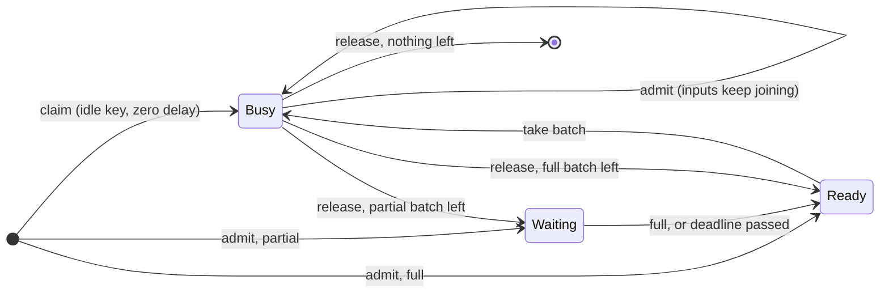
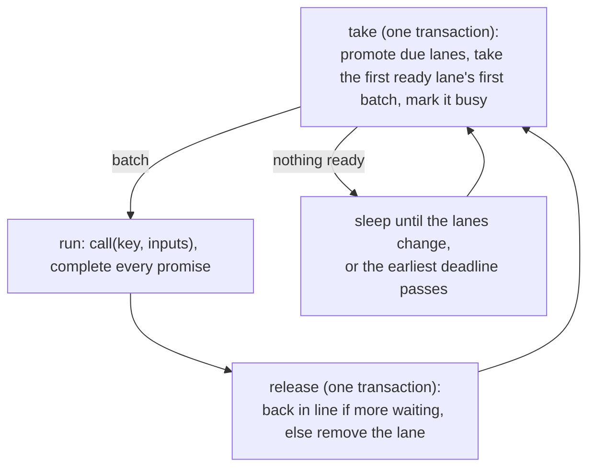

# `BulkDike.perKey`: lanes in one transactional value

`perKey` splits into a pure core and an effectful shell:

- **`Lanes`** is an immutable value holding the whole waiting room. Every scheduling decision (admit, claim, take,
  release, drain) is a pure function from one `Lanes` to the next.
- **`PerKeyDike`** keeps that value in one `TRef`, applies each transition in one STM transaction, and runs the calls:
  workers for batches, and callers themselves for direct calls.

The design is recorded in [0003](../decisions/0003-per-key-batching.md),
[0004](../decisions/0004-dispatch-on-completion.md), [0010](../decisions/0010-direct-calls-for-idle-keys.md) and
[0011](../decisions/0011-pluggable-dispatch-order.md).

## The waiting room

| Field | Holds |
|---|---|
| `lanes: Map[K, Lane]` | a lane per key that has inputs waiting or a call in flight |
| `ready: Queue[K]` | keys whose lanes can be taken, first come, first served |
| `waiting: TreeMap[Long, Vector[K]]` | keys with a partial batch, by deadline |
| `queued`, `weight` | inputs waiting, and their total weight, across all keys |
| `busy` | calls in flight, batched or direct |

A lane holds its items in ascending rank, ties in arrival order, and their total weight. An item carries the
caller's entry, its weight, its submission time and its rank, all computed before the transaction.

Memory is proportional to what is waiting, not to the number of keys ever seen: a lane is removed as soon as it is
empty and idle.

## A lane's states

- **Waiting(deadline)**: a partial batch whose oldest input is not yet due. The deadline is the oldest input's
  submission time plus `maxBatchDelay`, whatever its rank. With zero delay, a waiting lane is due at once.
- **Ready**: in line to be taken.
- **Busy**: a batch, or a direct call, is in flight. Inputs keep joining, but the lane is never taken again until it
  is released. This is the guard that keeps one call in flight per key.

A lane that still holds inputs when released joins the back of the ready line, so a key that is always busy cannot
starve the others.

## Admission

`apply` first computes the key, rank and weight, outside any transaction. Then one transaction does all of this:

1. If the dike is closed, the caller is interrupted.
2. Else, if direct calls are on, the delay is zero and the key has no lane, the key is **claimed**: a busy lane with no
   items is created, and the caller sends its input itself.
3. Else, if the waiting room has room by count and weight, the item is **admitted** into its key's lane, in rank order.
4. Else the caller gets `Rejected`.

Because the open check and the change to the lanes are one transaction, no input can enter after close has drained
the lanes.

## Workers

`maxInFlightBatches` workers loop forever:

A batch is the lane's longest prefix that fits `maxBatchSize` and `maxBatchWeight`, but always at least one input.
Taking a batch and recording it as owned by the worker happen in one uninterruptible step, so an interrupted worker
can always answer its callers. Entries whose callers were interrupted while waiting are dropped before the call.

An idle worker waits on an STM `retry` until the `TRef` changes, with a timeout at the earliest deadline. Every
admission wakes every idle worker; with a handful of workers this is cheap, and only the first finds work.

## Direct calls

A caller that claimed its key:

1. forks the call into the dike's scope, so closing the scope interrupts it like any batch in flight;
2. waits for the call, and interrupts it if the caller is interrupted;
3. releases the key **only once the call is over**, whether it succeeded, failed or was interrupted.

Releasing before the call is over would let the key's next batch overtake a call still on the wire. The formal model
shows this: without it, a key has two calls in flight.

## Close

The scope's finalizers interrupt the workers first. Then one transaction marks the dike closed and drains every lane,
and every drained caller is interrupted. Lanes with a call in flight stay busy until that call is released.

## Why one `TRef`

Admission must be atomic with the closed check, and taking a batch must be atomic with marking its key busy. With all
state in one value, both are single transactions, which rules out by construction the races
[`make`](single-queue.md) guards with a lock and an uninterruptible region. The cost is that every caller contends on
one `TRef`. If a measurement ever shows that to limit throughput, several dikes over shares of the keys spread it
without changing any guarantee ([Scaling beyond one dike](../guide/configuration.md#scaling-beyond-one-dike)).
