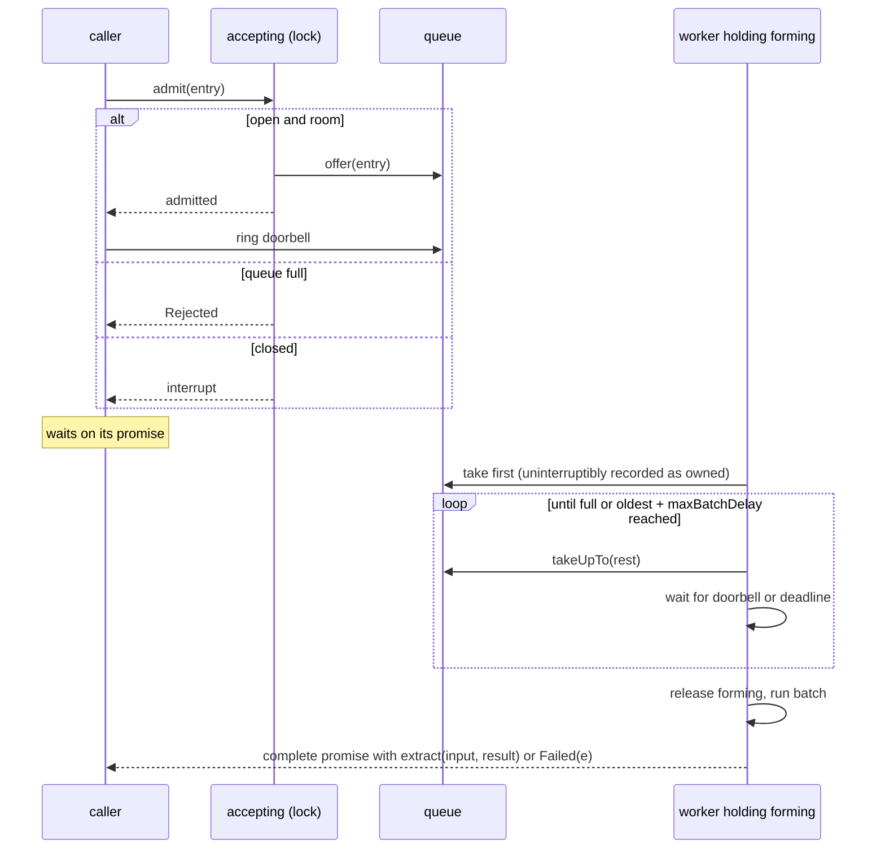

# `Ferry.make`: one queue, one batch assembled at a time

`make` (and `keyed`, which is built on it) batches one undifferentiated stream. Its design is recorded in
[0001](../decisions/0001-single-queue-batcher.md).

## Parts

| Part | What it is | Why |
|---|---|---|
| `queue` | a bounded, dropping queue of entries (input, promise, submission time) | a full queue refuses at once instead of blocking: `Rejected` |
| `doorbell` | a sliding queue of size 1, rung on every admission | wakes a worker that is waiting for more inputs before its deadline |
| `accepting` | a `Ref.Synchronized[Boolean]` | serialises admission with close, so nothing enters a drained queue |
| workers | `maxInFlightBatches` fibers, forked in the scope | each assembles and runs one batch at a time |
| `forming` | a semaphore with one permit | only one worker assembles at a time, so a batch is never split between two idle workers |
| `inFlight` | a counter | for `metrics` |

## A call

## Assembling a batch

A worker takes the `forming` permit, then blocks on the queue for a first entry. The batch's deadline is that entry's
submission time plus `maxBatchDelay`. Because the deadline belongs to the oldest input, not to when assembly started,
an input that waited while every slot was busy goes out as soon as a slot frees.

The worker then takes whatever else is waiting, up to `maxBatchSize`. If the batch is not full and the deadline has not
passed, it waits for the doorbell or the deadline, whichever comes first, and tries again. A stale ring costs only one
extra empty take.

It releases `forming` before running the batch, so the next batch can form while this one is in flight.

## Never stranding a caller

- Taking entries off the queue and recording them as owned by the worker is one uninterruptible step. An interrupted
  worker interrupts every caller it owns.
- Before calling, the worker drops entries whose promise is already complete: their callers were interrupted while
  waiting.
- On close, `accepting` is set to false under the lock, then the queue is drained and every entry's caller is
  interrupted. Workers are interrupted first, since finalizers run in reverse order.

`formal/Ferry.tla` models these steps. Its weakened variants show each one is needed: without serialised admission,
cleanup on interrupt, or the atomic take, a caller is stranded. See [Verification](../verification.md).
