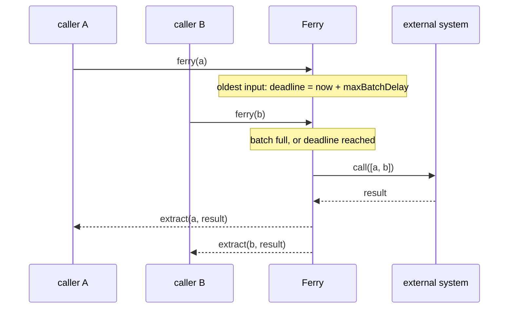

# Batching calls

`Ferry.make` and `Ferry.keyed` batch one stream of independent calls. Use them in front of an API that accepts
many inputs per request, where the cost of a request barely depends on how many inputs it carries.

If the inputs belong to entities whose updates must stay in order, use [`perKey`](per-key.md) instead.

## How a batch forms

Inputs wait in one bounded queue. A batch is sent as soon as either of these happens:

- `maxBatchSize` inputs are waiting;
- `maxBatchDelay` has passed since the **oldest** waiting input arrived.

At most `maxInFlightBatches` batch calls run at once. While every slot is busy, inputs keep waiting. An input whose
deadline passed while it waited is sent as soon as a slot frees, and its wait does not start over. When
`maxQueueing` inputs are already waiting, a new call fails at once with `FerryError.Rejected`.



## `keyed`: one result per distinct input

`keyed` is for a batch call that answers with a `Map` from input to result. Each distinct input is sent once per
batch, however many callers ask for it. A caller whose input is missing from the map gets `None`:

```scala
Ferry.keyed(config)((ids: NonEmptyChunk[UserId]) => profiles.fetch(ids)) // Ferry[UserId, E, Option[Profile]]
```

## `make`: any batch result

`make` takes the batch call and an `extract` function that picks one caller's result out of the batch result. Use it
when the result is not a map keyed by input:

```scala
--8<-- "Snippets.scala:make"
```

`make` passes every input to the batch call, duplicates included, in the order they were submitted.

If `extract` throws, only that caller fails, with the exception as a defect.

## Handling the answer

A call fails with a `FerryError[E]`:

```scala
--8<-- "Snippets.scala:outcomes"
```

| Outcome | Meaning | Worth retrying? |
|---|---|---|
| a result | the batch call succeeded, and `extract` picked this caller's share | — |
| `Rejected` | `maxQueueing` inputs were already waiting; nothing was sent | yes, after a backoff |
| `Failed(e)` | the batch call carrying this input failed with `e` | depends on `e` and on whether the call is idempotent |
| a defect | the batch call or `extract` died | no |
| interruption | the ferry's scope closed | the process is shutting down |

`toException` turns a `FerryError` into an exception, for code that works in `Task`.

## Retries, timeouts and circuit breakers

Ferry decides how many calls run and which inputs share them. It does not retry. Wrap the batch call in your
resilience policies, so that a retry or a timeout covers every caller in the batch at once. With
[rezilience](https://github.com/svroonland/rezilience):

```scala
--8<-- "PricingAggregation.scala:resilience"
```

Put the timeout innermost: it then bounds each attempt, while the retry bounds the attempts, and the breaker sees the
final outcome.

## Choosing the settings

- **`maxBatchSize`**: the downstream's per-request limit, or the size beyond which a bigger batch no longer saves
  anything.
- **`maxBatchDelay`**: the latency you are willing to add to a lone call so that others can join it. Zero sends
  whatever is waiting at once; batches then form only from calls that arrive while every slot is busy.
- **`maxInFlightBatches`**: the concurrency the downstream can take.
- **`maxQueueing`**: how much may wait before callers are turned away. Roughly: the rate you must absorb in a burst
  times the latency you can accept. It must be at least `maxBatchSize`.

See [Configuration and tuning](configuration.md) for the full reference and for monitoring.
