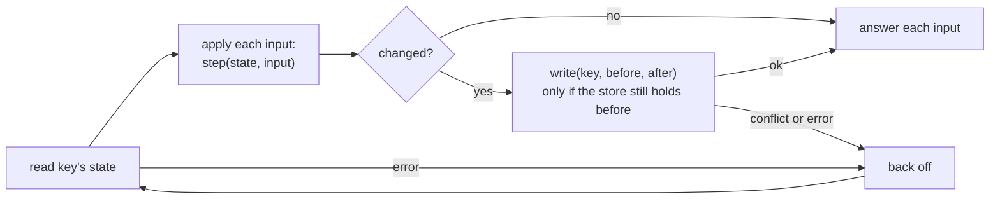

# Fenced writes with `FoldWrite`

There are two ways to process a batch of a key's inputs:

- **Hand it to the store's own group operation.** The batch call passes the batch through; no helper is needed.
- **Read once, apply in memory, write once.** Read the key's state, apply the inputs to it in order, and write the
  result only if the store still holds what was read. `FoldWrite` packages this round trip.

## The round trip



`FoldWrite(id, read, step, write, retry)`:

| Parameter | What it does |
|---|---|
| `id: I => Id` | Identifies an input. Inputs of one batch with the same id are applied once and share the first one's outcome. |
| `read: K => ZIO[R, E, S]` | Reads a key's state, including whatever makes the write conditional, such as a version or a length. |
| `step: (S, I) => (S, O)` | Your logic: the next state and the input's outcome. It must be pure: it runs again on every retry. |
| `write: (K, S, S) => ZIO[R, E, Any]` | Writes `after` if the store still holds `before`, and fails otherwise. Skipped when nothing changed. |
| `retry: Schedule[R, E, Any]` | When to retry the whole round trip after `read` or `write` failed. |

`fold.call` is the batch call and `fold.outcome` the extract:

```scala
--8<-- "OrderedWrites.scala:fold"
```

## Making retries safe

A write can land and its response be lost. The retry then reads a state that already contains the batch's inputs.
`step` must answer such an input from the state, without applying it again:

```scala
--8<-- "OrderedWrites.scala:step"
```

Here an invalid input gets its own rejection and fails no other input. An input already in the log is answered with
its position. Only a store error fails the batch, and that is the case `retry` retries.

## Putting it together

```scala
--8<-- "OrderedWrites.scala:wiring"
```

The [OrderedWrites example](https://github.com/EtaCassiopeia/bulkdike/blob/main/examples/src/main/scala/bulkdike/examples/OrderedWrites.scala)
runs this against a store that throttles one request in seven. It writes 300 entries in about two dozen requests, each
entry exactly once, ordered by effective day.

## Why not cache the state?

`FoldWrite` reads the state for every batch. Keeping it in memory between batches would save a read, but make the
process a second source of truth: wrong after a crash, after another process wrote the key, or after a routing change.
The store stays the only source of truth. See [0005](../decisions/0005-fenced-single-writer.md) and
[Running on a fleet](../architecture/fleet.md).

!!! note "All-or-nothing group operations"
    If the store's group operation rejects a whole group for one invalid input, validate in `call` before the round
    trip, or split and retry inside the call. The key stays busy meanwhile, so order is preserved.
