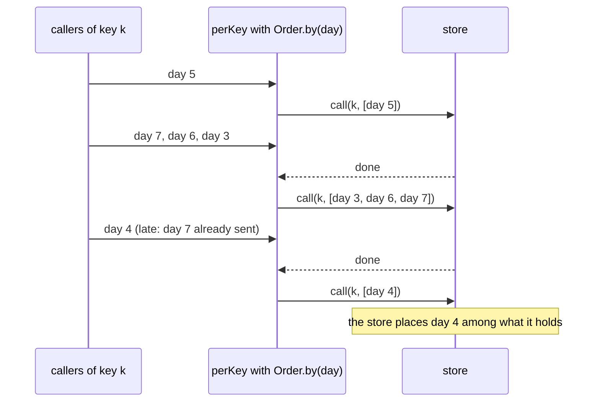

# Dispatch order

By default, `perKey` sends a key's inputs in the order they were submitted. Inputs often carry a time of their own,
such as the date something takes effect, and that time, not when the input happened to arrive, decides which comes
first. Inputs also arrive out of that order, with some latency.

An `Order` ranks each input. A key's waiting inputs are sent in ascending rank, ties in arrival order:

```scala
BulkDike.perKey(config, key = (e: Event) => e.entity, order = Order.by((e: Event) => e.at))(call)(extract)
```

| Order | Ranks by | Use it when |
|---|---|---|
| `Order.arrival` (default) | nothing: every input has the same rank | the store assigns positions itself, or arrival order is the order |
| `Order.by(rank)` | any `Long` an input carries | an effective date (`date.toEpochDay`), an instant (epoch milliseconds), a sequence number |
| your own `Order` | anything | `Order` has one method, so a lambda implements it |

```scala
--8<-- "Snippets.scala:custom-order"
```

`rank` is evaluated once per input, when it is submitted, and never inside a transaction. It must be pure, total and
cheap.

## Late inputs

An `Order` decides the order in which a key's inputs reach the store. It does not decide whether an input is correct;
the store does, because it holds the key's state.

- **Inputs that wait together are sent in rank order.** Under load, everything that arrived during the key's previous
  round trip waits together, so it is sorted together. That is a settling window of one round trip, at no added
  latency.
- **An input that arrives after inputs of a higher rank were already sent is not held back or rejected.** It goes in
  the key's next batch, in rank order among whatever is waiting then, and the store places it.



To give out-of-order inputs more time to meet, set a positive `maxBatchDelay`. A partial batch then waits up to that
long after its oldest input arrived, whatever that input's rank. The cost is that much latency on every input, and the
[direct path for idle keys](per-key.md#only-busy-keys-are-batched) is off.

## What is deliberately not built

Each of these was designed and left out until a store needs it. The reasons are in
[0011](../decisions/0011-pluggable-dispatch-order.md) and the [ordering proposal](../design/ordering.md).

- **Holding every input for a fixed time** (event time with a bound), for an append-only store that refuses an input
  older than its newest. It costs the bound in latency on every input.
- **Rejecting late inputs** before they reach the store.
- **Partition boundaries**, so that a batch never mixes, say, two days.
- **Waiting for gaps in sequence numbers.** Never in the batcher: the next expected number is the store's state, and
  waiting for an input that was lost never ends.
