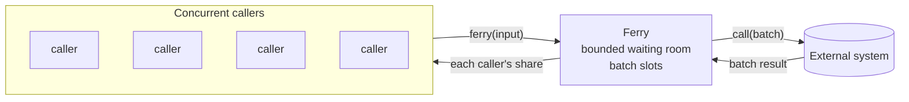

# Ferry

Ferry is a micro-batching bulkhead for [ZIO 2](https://zio.dev) and Scala 3. It sits between many concurrent callers
and an external system. It coalesces their individual calls into batched calls, limits how much load reaches the
system, and hands each caller its own share of the result.

The name is the idea: like a ferry, each batch carries whoever gathered while the previous one was away, and leaves as
soon as it is back. A lone passenger crosses at once; a crowd fills the next crossing. Ferry was called BulkDike
until [0013](decisions/0013-rename-to-ferry.md).



## Two ways to batch

`Ferry.make` and `Ferry.keyed`
:   Batch one stream of independent calls, such as price or profile lookups, to an API that accepts many per request.
    A batch leaves when it is full, or a fixed delay after its oldest input arrived. Several batches may be in flight
    at once. [Read more](guide/batching.md).

`Ferry.perKey`
:   Batch the writes of each entity separately and keep them in order, with at most one call in flight per entity.
    Quiet entities are not batched at all: their calls go straight through. Busy entities get batches that grow with
    load, at no added latency. Inputs can be sent in an order of your choice, such as an effective date.
    [Read more](guide/per-key.md).

## What it guarantees

- **Every caller gets an answer**: a result, a failure or an interruption. None is left waiting, not even when the
  scope closes mid-batch.
- **Overload fails fast.** A full waiting room rejects new calls at once, so latency does not grow without bound.
- **Per-key order** (`perKey`): a key's inputs are sent in order, and a key never has two calls in flight.
- **One caller's bad input fails only that caller**, if the batch call reports outcomes per input.

These are checked by simulations that inject crashes, lost responses and interruptions, by stress tests on the real
scheduler, and by [TLA+ models](verification.md) that check every interleaving of the protocol.

## At a glance

```scala
--8<-- "Snippets.scala:per-key"
```

[Get started](getting-started.md){ .md-button .md-button--primary }
[How it works](architecture/index.md){ .md-button }
